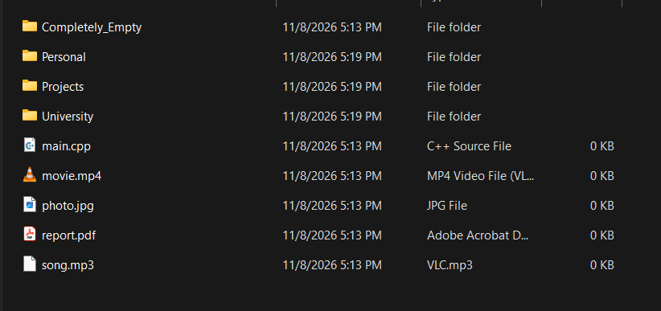
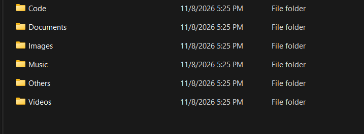
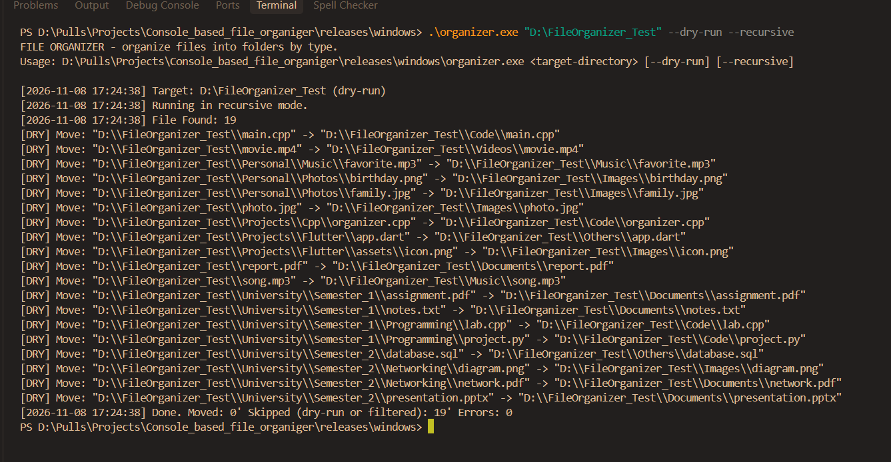
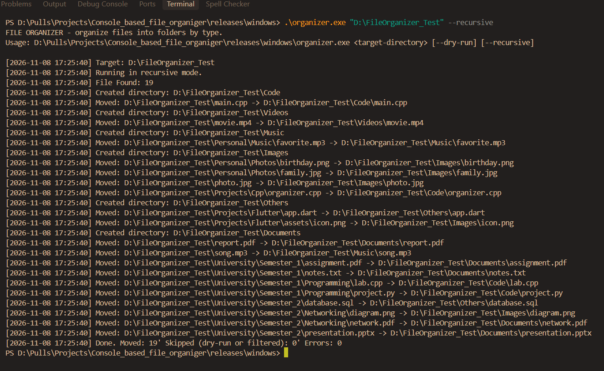

# Console Based File Organizer

A lightweight C++ command-line application that automatically organizes files into categorized folders based on their file extensions.

The project aims to simplify file management by reducing the effort of manually sorting files and keeping directories organized.

## Features

- **Automatic File Organization:** Automatically categorizes files based on their extensions.
- **Multiple File Categories:** Supports Images, Documents, Music, Videos, Code, Fonts, Archives, Others, and NoExtension.
- **Recursive Organization:** Processes files inside nested directories.
- **Dry Run Mode:** Preview file organization without actually moving files.
- **Operation Logging:** Keeps track of file organization activities.
- **Statistics:** Displays organization summaries and counters.
- **Command-Line Interface:** Simple and easy-to-use terminal commands.

## Download

Download the precompiled executable for your operating system from GitHub Releases.

| Operating System | Architecture | Download |
|---|---|---|
| Windows | 64-bit | [Download EXE](https://github.com/sunjirsanuj/Projects/releases/download/wv1.0.0/organizer.exe) |
| Linux | 64-bit | [Download Linux Binary](https://github.com/sunjirsanuj/Projects/releases/download/v1.0.0/organizer) |

**No C++ compiler installation is required when using the precompiled executable.**

## Screenshots


### Before Organization



### After Organization



### Dry Run Mode

<p align="center">
  
  
</p>

## Technologies Used

- **Language:** C++
- **Standard:** C++17
- **Library:** C++ Standard Library
- **File System:** `std::filesystem`
- **Compiler:** GCC / MinGW-w64

## Getting Started

You can use this application in two ways: download the precompiled executable or compile the source code yourself.

### Option 1: Download and Run

#### Windows

1. Download `organizer.exe` from [GitHub Releases](https://github.com/sunjirsanuj/Projects/releases/download/wv1.0.0/organizer.exe).
2. Open PowerShell or Command Prompt in the download directory.
3. Run the application:

```powershell
.\organizer.exe "D:\Downloads"
```

#### Linux

1. Download the Linux executable from [GitHub Releases](https://github.com/sunjirsanuj/Projects/releases/download/v1.0.0/organizer).
2. Open a terminal in the download directory.
3. Give execution permission:

```bash
chmod +x organizer
```

4. Run the application:

```bash
./organizer "/home/user/Downloads"
```

### Option 2: Compile from Source

#### Requirements

- C++17 compatible compiler
- GCC / G++
- Standard C++ Library

#### Clone the Repository

```bash
git clone https://github.com/sunjirsanuj/Console_based_file_organiger.git
```

Navigate to the source code directory:

```bash
cd Console_based_file_organiger/source_code
```

#### Windows Compilation

Using GCC / MinGW-w64:

```powershell
g++ -std=c++17 -O2 -static -static-libgcc -static-libstdc++ main.cpp -o organizer.exe
```

Run:

```powershell
.\organizer.exe "D:\Downloads"
```

#### Linux Compilation

On Ubuntu/Debian, install GCC if it is not already installed:

```bash
sudo apt update
sudo apt install g++
```

Compile the application:

```bash
g++ -std=c++17 -O2 main.cpp -o organizer
```

Run:

```bash
./organizer "/home/user/Downloads"
```

*If the project contains multiple `.cpp` files, include all required source files in the compilation command.*

## Usage

The application accepts a target directory and optional command-line arguments.

### Basic Organization

Organizes files in the specified directory.

**Windows:**

```powershell
.\organizer.exe "D:\Downloads"
```

**Linux:**

```bash
./organizer "/home/user/Downloads"
```

### Dry Run Mode

Previews the organization process without actually moving files.

```bash
./organizer "/home/user/Downloads" --dry-run
```

### Recursive Organization

Processes files inside the target directory and its nested subdirectories.

```bash
./organizer "/home/user/Downloads" --recursive
```

### Combine Options

Previews recursive organization without moving any files.

```bash
./organizer "/home/user/Downloads" --dry-run --recursive
```

### Command-Line Arguments

| Argument | Description |
|---|---|
| `target-directory` | Directory containing the files to organize |
| `--dry-run` | Preview operations without moving files |
| `--recursive` | Include nested directories |

*For Windows, replace `./organizer` with `.\organizer.exe` and use a valid Windows directory path.*

## Supported File Categories

| Category | Examples |
|---|---|
| Images | JPG, JPEG, PNG, GIF |
| Documents | PDF, DOCX, TXT, PPTX |
| Music | MP3, WAV |
| Videos | MP4, MKV, AVI |
| Code | CPP, C, PY, HTML, CSS, JS |
| Fonts | TTF, OTF |
| Archives | ZIP, RAR, 7Z |
| Others | Other recognized file extensions |
| NoExtension | Files without extensions |

*The exact extensions supported depend on the project's implementation.*

## Project Structure

```text
Console_based_file_organiger/
│
├── source_code/
│   └── main.cpp
|
├── releases/
│   ├── linux
|   |   └── organizer
│   ├── windows
|       └── organizer.exe
│
├── screenshots/
│   ├── before.png
│   ├── dry-run_and_recursive.png
│   ├── after.png
│   └── dry-run_and_recursive.png
│
├── README.md
```

*The structure above is illustrative. Adjust it to match the actual repository.*

## Learning Outcomes

Through this project, I explored and practiced:

- C++17 and modern C++ features.
- File and directory handling using `std::filesystem`.
- Command-line argument parsing.
- Recursive directory traversal.
- File categorization using extensions.
- Basic error handling and logging.
- Working with real-world file management problems.

## Future Improvements

- Support for additional file formats.
- Improved file conflict handling.
- More detailed organization reports.
- Custom file category configuration.
- Further cross-platform improvements.

## Contributing

Contributions are welcome!

If you have ideas for improvements, bug fixes, or new features, feel free to contribute.

1. Fork this repository.
2. Create a new branch:

```bash
git checkout -b feature/your-feature-name
```

3. Make your changes.
4. Commit your changes:

```bash
git commit -m "Add: your feature description"
```

5. Push your branch:

```bash
git push origin feature/your-feature-name
```

6. Open a Pull Request.

If you find a bug or have a suggestion, feel free to open an issue.

---

**Developed by [Md Sunjir Islam Sanuj](https://github.com/sunjirsanuj)**

If you find this project useful, consider giving the repository a ⭐.